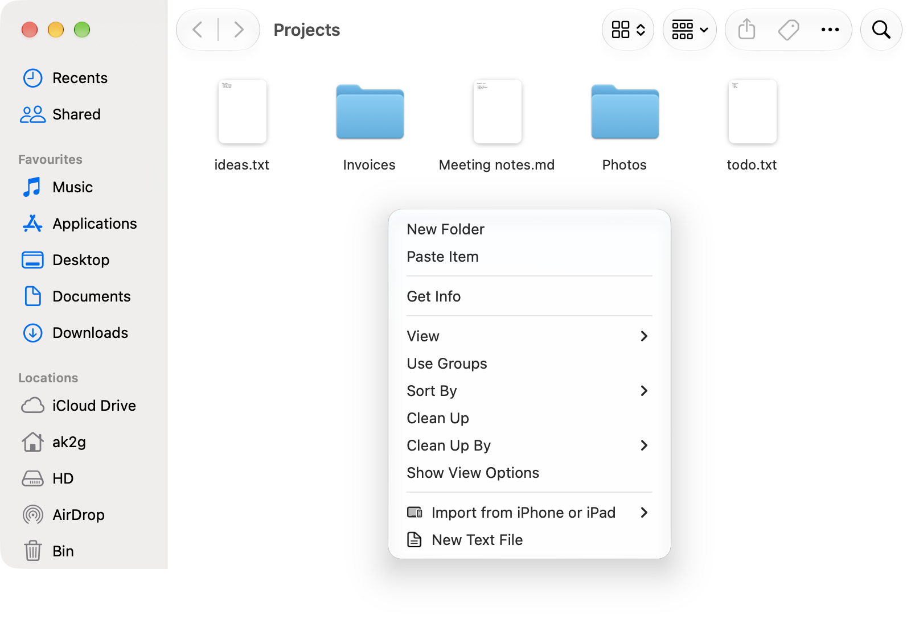

<div align="center">

# Mac New Text File

**Add “New Text File” to the Finder right‑click menu on macOS.**

Right‑click inside any folder → **New Text File** → an empty `untitled.txt` appears. Just like Windows.

[](https://github.com/ak2g/mac-new-text-file/actions/workflows/build.yml)


[](LICENSE)



</div>

---

## Why?

macOS Finder has **New Folder** but no way to create a new file. To make a simple text file you have to
open TextEdit, switch it to plain text, pick a folder in the save dialog, and type a name. Or use Terminal.

This project adds the missing menu item using Apple's official **Finder Sync extension** API. It's a
tiny native app (under 80 lines of Swift). It doesn't use Automator or AppleScript hacks, doesn't
collect any data, and doesn't make network calls.

## Features

- **Right‑click on empty space** in any Finder window → creates `untitled.txt` in that folder.
- **Right‑click on a folder** → creates the file *inside* that folder.
- **Right‑click on a file** → creates the file next to it.
- **Never overwrites.** If `untitled.txt` exists you get `untitled 2.txt`, `untitled 3.txt`, …
- Native and lightweight. The extension sits idle until you right‑click in Finder.

## Requirements

- macOS 12 Monterey or later (developed and tested on Apple silicon)
- Xcode **or** just the free Command Line Tools: `xcode-select --install`

You build it yourself from source. It takes about 10 seconds, and because you compiled it on your own
Mac, there are no "unidentified developer" warnings.

## Install

```bash
git clone https://github.com/ak2g/mac-new-text-file.git
cd mac-new-text-file
./scripts/install.sh
```

That's it. The script builds the app, copies it to `/Applications/NewTextFile.app`, and turns on the
Finder extension. Right‑click inside any Finder window and you'll see **New Text File** near the bottom
of the menu.

> If the menu item doesn't show up straight away, see [Troubleshooting](docs/troubleshooting.md).
> Usually you just need to enable it once in System Settings.

## Usage

| Right‑click on…              | Result                                        |
|------------------------------|-----------------------------------------------|
| Empty space in a folder      | `untitled.txt` is created in that folder      |
| A folder                     | `untitled.txt` is created inside that folder  |
| A file                       | `untitled.txt` is created next to that file   |

To rename the new file, click it once and press <kbd>Return</kbd>.

## Update

```bash
cd mac-new-text-file
git pull
./scripts/install.sh
```

## Uninstall

```bash
./scripts/uninstall.sh
```

This disables the extension and deletes `/Applications/NewTextFile.app`. Nothing else is left behind.

## Enabling / disabling the menu item

The extension can be switched on and off without uninstalling:

| macOS version  | Where                                                                    |
|----------------|--------------------------------------------------------------------------|
| 15 and later   | System Settings → General → Login Items & Extensions → Extensions        |
| 13 – 14        | System Settings → Privacy & Security → Extensions → Added Extensions     |
| 12             | System Preferences → Extensions → Added Extensions                       |

Or from Terminal:

```bash
pluginkit -e use    -i local.newtextfile.app.finder   # enable
pluginkit -e ignore -i local.newtextfile.app.finder   # disable
```

## How it works

`NewTextFile.app` is only a container. The real work happens in a **Finder Sync extension** inside it
(`NewTextFileExtension.appex`), which Finder loads and asks for extra menu items whenever you
right‑click. When you choose **New Text File**, the extension finds out which folder you clicked in and
writes an empty file there.

There's no Xcode project. `scripts/build.sh` compiles both pieces with `swiftc`, assembles the app
bundle by hand, and code‑signs it. Read [docs/how-it-works.md](docs/how-it-works.md) for the full
walkthrough.

## Project structure

```
mac-new-text-file/
├── Sources/
│   ├── App/main.swift                    # Host app: registers and enables the extension
│   └── FinderExtension/FinderSync.swift  # The right-click menu item + file creation
├── Resources/
│   ├── App-Info.plist                    # Host app bundle metadata
│   ├── Extension-Info.plist              # Declares the com.apple.FinderSync extension point
│   └── Extension.entitlements            # Sandbox + permission to write files
├── scripts/
│   ├── build.sh                          # Compile, assemble and sign → build/NewTextFile.app
│   ├── install.sh                        # build + copy to /Applications + enable
│   └── uninstall.sh                      # Disable + remove
├── docs/
│   ├── how-it-works.md                   # Architecture and build details
│   ├── troubleshooting.md                # Fixes for common problems
│   └── images/
└── .github/workflows/build.yml           # CI: builds on every push and pull request
```

## Privacy & security

- **No network access, no analytics, no background activity.** The extension only does anything when you right‑click in Finder.
- Finder extensions **must** run in Apple's App Sandbox. To be able to create a file in whatever folder
  you right‑click, the extension is granted write access to the file system
  (`Resources/Extension.entitlements`). The only file operation in the code is writing one empty
  `.txt` file. It's about 60 lines, so you can check it yourself in
  [`FinderSync.swift`](Sources/FinderExtension/FinderSync.swift).
- The build is signed with your own Apple Development certificate if you have one, otherwise
  ad‑hoc. Either way it never leaves your Mac.

## FAQ

**Can I get other file types (`.md`, `.json`, …)?**
Not out of the box, because this project deliberately does one thing. It's a one‑line change in
`FinderSync.swift` (`untitled.txt` → `untitled.md`). Pull requests for a configurable list are welcome.

**Why not an Automator Quick Action?**
Quick Actions only appear when you right‑click a *selected item*, and they're tucked inside a
submenu. They never appear when you right‑click empty space in a folder, which is where you actually want
"New Text File". Only a Finder Sync extension can add items there.

**Will it survive macOS updates?**
Usually yes. If the menu item ever disappears, re‑run `./scripts/install.sh` or just open
`/Applications/NewTextFile.app` once; it re‑registers and re‑enables the extension.

## Contributing

Issues and pull requests are welcome. See [CONTRIBUTING.md](CONTRIBUTING.md).

## License

[MIT](LICENSE)
